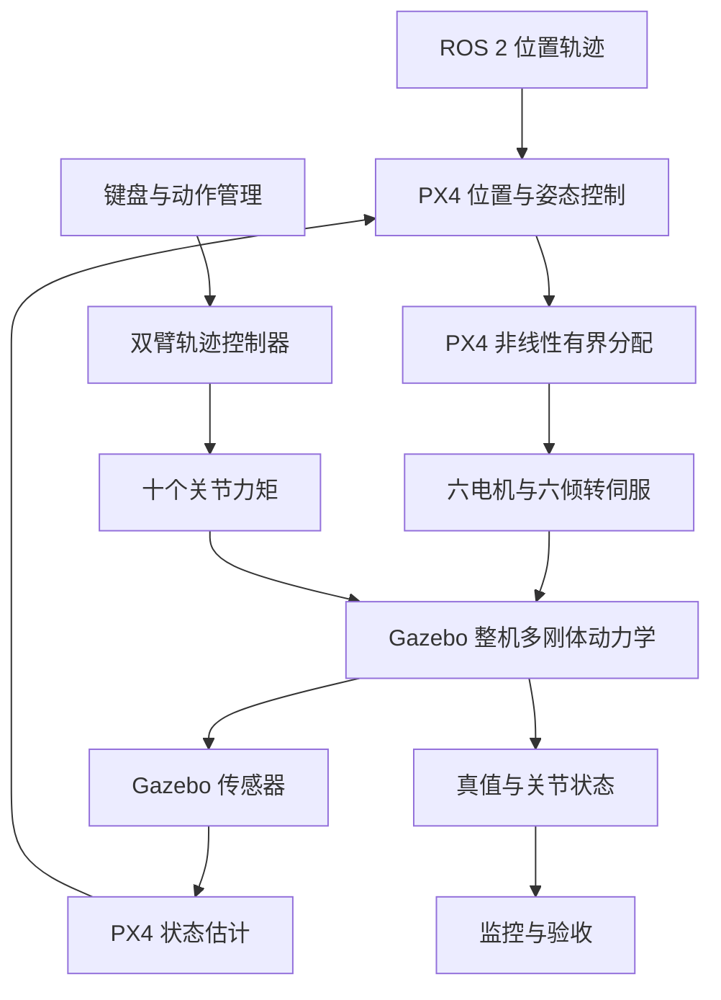

# Dragonfly 软件架构

Dragonfly 当前由 ROS 2 仿真与任务层、PX4 原生飞控、Gazebo 多刚体仿真以及独立的 ESP32 机械臂固件组成。默认飞行控制与分配在 PX4 内完成；ROS 硬件驱动和实机双臂主从闭环仍待接入。

更新日期：2026年10月13日。

## 源码与运行环境

| 位置 | 职责 |
|---|---|
| `/home/ubuntu/Dragonfly` | WSL Ubuntu 实际运行仓库，包含 dragonfly_arm 与 dragonfly_flight |
| `C:\Users\LENOVO\Documents\ChatGPT\dragonfly` | 项目记忆与本机历史输出 |
| `C:\Users\LENOVO\Desktop\arm\RoArm-M3_example` | 当前机械臂 ESP32/Arduino 固件工程 |
| `C:\Users\LENOVO\Desktop\arm\src` | 机械臂固件依赖库 |
| `C:\Users\LENOVO\Desktop\Dragonfly` | 桌面镜像，不作为仿真运行源码入口 |

当前记录的环境为 Ubuntu 22.04、ROS 2 Humble、Gazebo Harmonic 8.15、PX4 v1.16.2、Micro XRCE-DDS Agent v2.4.3，配套 px4_msgs 与 gz_ros2_control 工作区。飞行构建使用 build-flight 和 install-flight。

## 当前控制与数据流

默认模式为 `px4_native`，使用独立机型 40160。ROS 下发 Offboard 位置轨迹，PX4 负责位置/速度、姿态/角速度控制及六电机六倾转分配；该模式 ROS 不创建飞行执行器发布者。

控制反馈来自 PX4 估计状态。Gazebo 真值用于起飞前原点对齐、机体 TF、动臂许可与结果评价。机械臂反作用通过多刚体物理耦合产生，未额外叠加同一份人工扰动力。接入实机时必须替换对真值的依赖。

## 模块职责

以下路径均相对 `/home/ubuntu/Dragonfly`。

| 模块 | 主要职责 |
|---|---|
| `src/dragonfly_arm/config/model_dimensions.yaml` | 几何、安装、硬件规格与质量参数的共同来源 |
| `src/dragonfly_arm/urdf` | 整机、倾转平台、五轴臂与碰撞体，固定演示和飞行共用 Xacro |
| `src/dragonfly_arm/dragonfly_arm_kinematics` | 正运动学、逆运动学与雅可比 |
| `src/dragonfly_arm/scripts/kinematics_node.py` | 工具位姿发布与左右臂 IK 服务 |
| `src/dragonfly_flight/dragonfly_flight/model.py` | 飞行模型及配置生成 |
| `src/dragonfly_flight/dragonfly_flight/native.py` | 原生 PX4 参数适配 |
| `src/dragonfly_flight/dragonfly_flight/arms.py` | 点动、回放、停止、运动许可与轨迹管理 |
| `src/dragonfly_flight/dragonfly_flight/runtime.py` | 运行时通信、任务流程、监测与记录 |
| `src/dragonfly_flight/dragonfly_flight/run.py` | 模式选择、仿真与子进程生命周期 |
| `src/dragonfly_flight/src/physics.cpp` | Gazebo 物理执行与反馈 |
| `src/dragonfly_flight/dragonfly_flight/verify.py` | 悬停、平移、动臂与限幅验收 |
| `src/dragonfly_flight/config/px4_vector` | PX4 适配补丁、参数说明与原版参考 |

`px4_actuators` 保留旧 ROS 控制与分配调试路径；`ideal_wrench` 和 `physics` 用于物理诊断。它们与默认原生链路用途不同，实验记录必须带上运行模式。

## 模型与接口约定

长度用 m，角度用 rad，力矩用 N·m。Gazebo 世界系为 ENU、机体系使用 FLU；PX4 位置参考为 NED、推力与机体系为 FRD，接口处统一转换。

每臂关节顺序为底座、肩、肘、腕俯仰、末端滚转。仿真共有十个机械臂关节和六个倾转关节；夹爪当前固定。三组动力单元各自共用双轴倾转，不能当成六个旋翼独立单轴倾转。

| 接口 | 约定 |
|---|---|
| `/left_arm_controller/follow_joint_trajectory` | 左臂五关节，left_joint_1 至 left_joint_5 |
| `/right_arm_controller/follow_joint_trajectory` | 右臂五关节，right_joint_1 至 right_joint_5 |
| `/joint_states` | 关节位置与速度状态 |
| `/left_arm/tool_pose`、`/right_arm/tool_pose` | 各自基座坐标系下的工具位姿 |
| `/left_arm/solve_ik`、`/right_arm/solve_ik` | 只返回逆解，不自动执行运动 |
| `/dragonfly/truth` | uav_base_link 原点的世界 ENU 真值 |
| `/dragonfly/ready` | 展开完成、机体稳定且机械臂空闲时为真 |

飞行中的动作管理器通过同一轨迹控制器的 joint_trajectory topic 下发轨迹；左右 action 接口继续保留。飞行入口停用旧演示和 tilt_controller，避免同一执行器被重复控制。

## 执行器与参数边界

固定基座演示使用位置接口；自由飞行的双臂使用 500 Hz effort 轨迹控制器。正常运行通过力矩驱动关节，不持续重设关节位置。

每臂按五关节顺序采用峰值限幅 `[2.941995, 5.883990, 2.941995, 2.941995, 2.941995] N·m`，肩部按两只舵机理想共同输出计算。生成的 model.json 以完整关节名保存 arm_effort_limits，URDF、执行层及验收共用该来源。峰值参数不等于持续力矩。

整机模型质量为 5.415 kg。原生控制使用竖直构型固定标称质心与惯量，起飞、展开和动臂时不实时更新。分段质量、惯量、推力曲线和倾转响应仍含仿真假设。

## 当前机械臂固件

固件主程序为 `RoArm-M3_example.ino`；`RoArm-M3_module.h` 实现关节控制、舵机反馈和整臂目标下发，`RoArm-M3_config.h` 保存配置。`json_cmd.h` 定义指令，`uart_ctrl.h` 中的 jsonCmdReceiveHandler 负责分发；UART、Wi-Fi/HTTP 和 ESP-NOW 提供通信入口，网页在 `m3_web_page.h`。

六个逻辑目标为 base、shoulder、elbow、wrist、roll、hand，对应七个物理舵机。当前 ID 为底座 11、肩主动 12、肩从动 13、肘 14、腕 15、滚转 16、夹爪 17。整臂函数最终同步写入七个舵机目标。

`moveToRecordedInitialPose()` 发送自定义上电姿态，速度参数为 100、加速度参数为 8，函数内部不等待舵机精确到位。主循环处理串口、网页请求、连续运动、反馈及 ESP-NOW。目标已发送不等于机械臂已到位，联调时应检查真实反馈。

| 项目 | 仿真 | 当前固件源码 |
|---|---|---|
| 起飞或上电姿态 | 折叠 `[0,0,π/2,0,0]` | 五轴 `[0.124252444,-1.526310884,2.997398460,-0.150330117,0.006135923]`，夹爪 3.129320807 rad |
| 工作姿态 | 竖直 `[0,0,0,0,0]`，为 H/P 基准 | 不应与自定义上电姿态混同 |
| 末端偏移 | 图纸值 13.29 mm | 配置值 13.69 mm |
| 夹爪 | 固定几何体 | 独立逻辑关节 hand |

当前固件路径与实现已经确认，实物烧录版本和硬件验证状态仍待确认。固件位置执行接口与仿真 effort 接口并不等价。

## 待接入的实机架构

拟采用的逻辑分工为：主臂输入 → 映射与接管对齐 → 运动约束与轨迹 → ROS 硬件驱动 → ESP32 固件 → 舵机；真实关节反馈返回状态与监控层。具体传输方式和设备拓扑待确定，不将现有通信入口视为已完成的端到端主从系统。

接入顺序是统一关节与姿态定义、校准固件和模型参数、打通单臂闭环，再验证双臂连续遥操作。飞控同时校准电机与倾转通道、真实定位、质量惯量和执行器响应，随后合并两条实机链路。

## 运行与异常处理

常用入口为 `bash /home/ubuntu/Dragonfly/src/dragonfly_flight/scripts/sim.sh --gui --record`；另开终端以 keyboard 和 monitor 参数启动操作与监控。

当前仿真对 PX4 估计过期 0.2 仿真秒、执行器或分配遥测过期 0.25 仿真秒、非法状态或离开已解锁 Offboard 中止运行并保留日志。键盘心跳丢失 0.5 墙钟秒停止手动动作。停止键盘或机械臂不等于停止飞行；主运行终端退出才结束整次仿真。

上述异常策略属于 SITL 实现，不能直接代替真实飞行的失联与处置方案。

## 依据与关联文档

架构依据为当前 WSL 工程 README、dragonfly_flight 运行说明与代码，以及 `C:\Users\LENOVO\Desktop\arm\RoArm-M3_example` 内的主程序、关节控制、配置和通信代码。

产品目标与验收边界见 [Dragonfly 产品需求](产品需求.md)。
